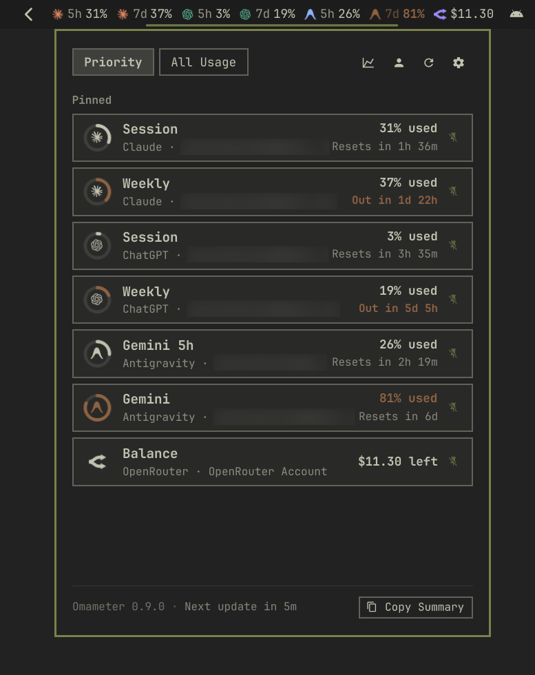
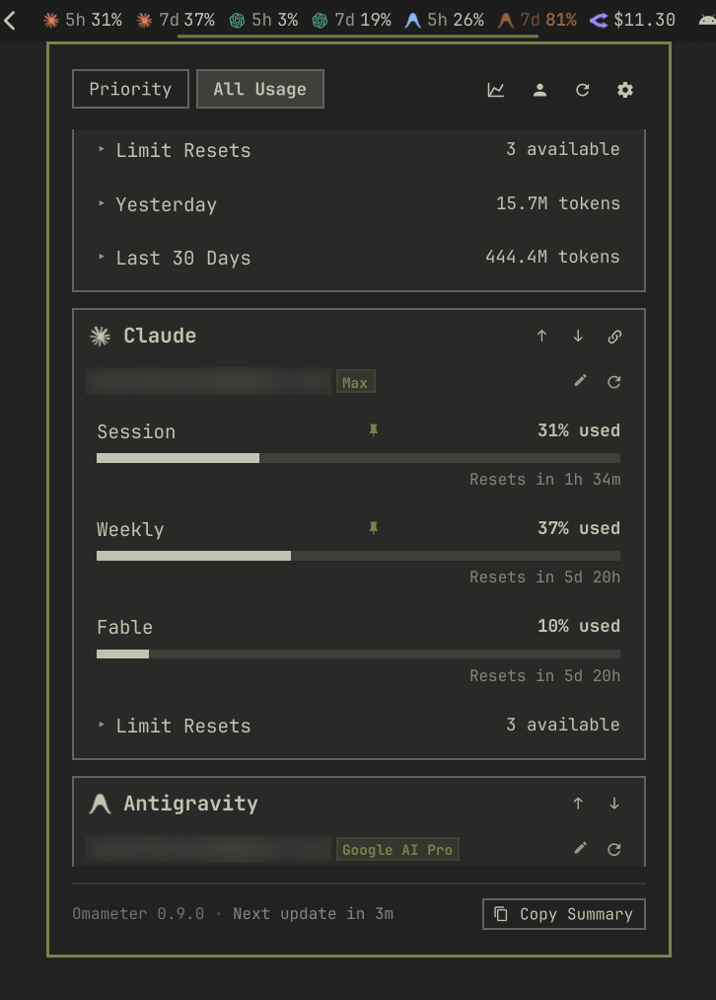
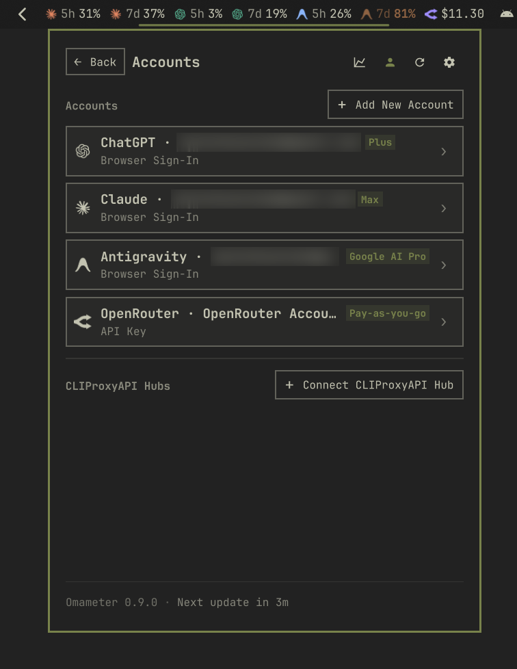

# Omameter

**Your AI coding subscription limits, live in the Omarchy top bar.**

Omameter is a native [Omarchy](https://omarchy.org) shell plugin (`service` + `bar-widget`, built on Quickshell) that tracks the usage limits of your AI coding subscriptions — Claude, ChatGPT/Codex, Cursor, GitHub Copilot and more — and shows the ones closest to running out right in the top bar. It follows the active Omarchy theme, fonts, animation settings and language, and its backend is a small Python 3 daemon with **no dependencies beyond the standard library**.

> **Screenshots**
>
> _Coming soon._ <!-- Add images to docs/screenshots/ and reference them here, e.g.:
> 
> 
> 
>  -->

---

## Features

- **Top bar strip** — shows the most urgent (or pinned) limits next to each provider's monochrome icon, with initials when you have several accounts and a `+N` overflow count.
  - Three label styles: **Full** (metric names), **Compact** (window tags such as `5h`, `7d`) and **Icons** (window glyphs only).
  - Up to **5 items in Full** style, or up to **8 in Compact / Icons**; `0` shows just the Omameter icon.
  - **Top Bar Items**: pick exactly which metrics appear, in the order you choose (order is preserved). With *Always show in top bar* off, the bar stays quiet (icon only) until something needs attention.
  - Scroll over the widget to cycle through overflowing items.
- **Hover card** — hover the widget for a summary grouped by provider and account, with compact values, reset countdowns and burn indicators.
- **Priority tab** — rings (`PriorityRing`) sorted into *Pinned*, *Running Out* (including **Burning Fast**), *Use It or Lose It*, *Needs Attention*, *Used Up* and *All Clear*.
- **All Usage tab** — every account and metric as bars with the main figure up front, live reset countdowns, pace hints, expandable usage breakdowns (top models + Other), pin/hide/reorder and inline rename.
- **Pace marks** — optional tick on each bar and ring showing where an even pace through the window would be; inline "~X% left at reset" / "Out in 1h 40m" projections.
- **Burning Fast** — flags limits projected to run out before they reset at the current pace (with 90% recovery hysteresis).
- **Use It or Lose It** — multi-day limits resetting within 24 hours with more than 50% left.
- **Unified Accounts** — merge several Claude or ChatGPT accounts into one card (members stay visible).
- **Rate-Limit Resets** — see and redeem available limit resets (Claude, ChatGPT/Codex, Z.ai) with a two-step confirm, plus expiry warnings.
- **Desktop notifications** (`notify-send`) — Warning, Critical, Burning Fast, Use It or Lose It and expiring resets, each optional, fired once per window.
- **Accounts manager inside the panel** — browser OAuth (loopback, dual-stack IPv4/IPv6), Device Code, API keys and CLIProxyAPI hubs; the sign-in flow survives the popup closing when the browser takes focus.
- **Opt-in local import** — a *Detect Local Logins* button imports existing Claude Code, Codex CLI, GitHub CLI (`gh`) logins or API-key environment variables, on demand only.
- **Secure storage** — credentials live in the system keyring via `secret-tool` (libsecret), with a `0600` file fallback; tokens never reach the QML side or logs.
- **Privacy mode** — icon-only top bar and masked account names.
- **Proxy support** — SOCKS5, HTTP or HTTPS proxy for all requests.
- **`omameter` CLI** — read-only JSON (`omameter.limits.v2`) from the local cache, for scripts and status bars.
- **Languages** — English and Brazilian Portuguese (`en`, `pt-BR`), following *Omarchy Setup → Language* live.

## Supported providers

| Provider | Sign-in | Metrics |
|---|---|---|
| **Claude** | Browser OAuth, or import from Claude Code | Session (5h), Weekly (7d), Sonnet, Fable, Extra Usage, Limit Resets |
| **ChatGPT / Codex** | Browser OAuth, Device Code, or import from Codex CLI | Session, Weekly, Spark, Spark Weekly, Extra Usage, Credit Limit, Limit Resets, Today / Yesterday / Last 30 Days |
| **Cursor** | Browser OAuth | Total Usage, Cursor Models, Other Models, Extra Usage, Grok Bot, Requests, Credits, Today / Yesterday / Last 30 Days |
| **Amp** | Device Code | Agent Usage, Orb Hours, Amp Free, Individual Credits |
| **Antigravity** | Google OAuth | Gemini 5h, Gemini Weekly, Argon Weekly, Claude 5h, Claude Weekly |
| **GitHub Copilot** | Device Code (`github.com` or `*.ghe.com`), Organization Billing token, or import from `gh` | Credits, Extra Usage, Chat, Completions, Org Credits, Org Spend |
| **Devin** | Browser OAuth | Daily, Weekly, Extra Usage |
| **Grok** | xAI Device Code | Weekly, Extra Usage |
| **Muse Code** | Meta Device Code | Session, Weekly |
| **Ollama** | API key or `OLLAMA_API_KEY` | Session, Weekly, Monthly, Extra Usage, Requests, Today / Yesterday / Last 30 Days |
| **OpenCode** | Device Code, API key or `OPENCODE_API_KEY` | Session, Weekly, Monthly |
| **OpenRouter** | Management/API key or `OPENROUTER_API_KEY` | Balance, Today, Yesterday, This Week, This Month, Prior 30 Days, Key Limit, Budget, Free Requests |
| **Z.ai** | API key, `ZAI_API_KEY` or `ZHIPU_API_KEY` | Session, Weekly, Web Searches, Limit Resets |
| **CLIProxyAPI hubs** | Hub address + management key | Mirrors the Claude, ChatGPT, Antigravity, Devin and Grok logins hosted on a [CLIProxyAPI](https://github.com/router-for-me/CLIProxyAPI) server |

Metrics depend on what each provider reports for your plan. Omameter reads the same usage endpoints the providers' own apps and CLIs use; these are not always public APIs and may change without notice.

## Requirements

- [Omarchy](https://omarchy.org) with the Quickshell-based `omarchy-shell` (plugin support).
- Python 3.11 or newer (standard library only).
- Optional: `secret-tool` (libsecret) for keyring storage, `notify-send` for notifications, `wl-copy` for *Copy Summary*, `curl` as a transport fallback.

## Installation

### From a checkout (recommended)

```bash
git clone https://github.com/paulimfavarato/omameter.git
cd omameter
./install.sh
```

`install.sh`:

1. validates the plugin with `omarchy plugin validate`;
2. copies the plugin (without symlinks, tests or CI files) to `~/.config/omarchy/plugins/paulimfavarato.omameter`;
3. installs the `omameter` CLI wrapper to `~/.local/bin/omameter`;
4. enables the widget on the right side of the top bar.

To **update**, pull and run `./install.sh` again: it replaces the installed copy and runs `omarchy-restart-shell` so the new QML and daemon load. Your accounts and settings are kept.

### With `omarchy plugin add`

```bash
omarchy plugin add https://github.com/paulimfavarato/omameter.git --enable
```

This clones the repository straight into the plugins folder (update later with `omarchy plugin update paulimfavarato.omameter`). It doesn't install the CLI; to get it, link the bundled script:

```bash
ln -s ~/.config/omarchy/plugins/paulimfavarato.omameter/bin/omameter ~/.local/bin/omameter
```

### Global shortcut (optional)

Bind a key in `~/.config/hypr/bindings.conf` to open the panel from anywhere:

```ini
bindd = SUPER ALT, U, Omameter, exec, omarchy-shell paulimfavarato.omameter toggle
```

Other IPC calls: `open`, `close`, `refresh` and `status` (JSON summary of the bar).

## Uninstall

```bash
./uninstall.sh            # remove the plugin and CLI, keep accounts and settings
./uninstall.sh --purge    # also delete Omameter's data and keyring entries
```

If you installed with `omarchy plugin add`, use `omarchy plugin remove paulimfavarato.omameter` (and delete the CLI link if you made one).

Data locations (kept unless you use `--purge`):

| Path | Contents |
|---|---|
| `~/.config/omameter/` | `accounts.json`, `settings.json`, `layout.json`, `proxy.json` |
| `~/.cache/omameter/snapshots.json` | last fetched usage (read by the CLI) |
| `~/.local/share/omameter/vault.json` | credentials, only when `secret-tool` is unavailable (`0600`) |
| keyring (`secret-tool`) | services `com.omarchy.omameter.accounts` and `com.omarchy.omameter.cliproxy-hubs` |

## Usage

### Top bar

| Action | Result |
|---|---|
| Left click | Open / close the panel |
| Middle click | Refresh all accounts now |
| Right click | Open Settings |
| Scroll | Cycle through overflowing items |
| Hover | Show the summary card |

### Inside the panel

| Key / action | Result |
|---|---|
| `1` / `2`, `Tab`, `←` / `→` | Switch between **Priority** and **All Usage** |
| `↑` / `↓` | Scroll |
| `r` or `Ctrl+R` | Refresh now |
| `s` or `Ctrl+,` | Open **Settings** |
| `a` | Open **Accounts** |
| `Ctrl+Z` | Undo the last layout change |
| `Esc` | Go back, or close the panel |
| Click a value | Toggle **remaining** / **used** |
| Click a reset time | Toggle **countdown** / **exact time** |

### Adding accounts

Open **Accounts** (`a`) → **Add Account**, pick a provider and a sign-in method. Browser sign-ins open your default browser and finish automatically; Device Code shows a code to enter; API keys are checked with a live request before they're saved. **Detect Local Logins** scans for existing CLI logins only when you click it.

## Configuration

Settings are available in the panel (**Settings**: General, Display, Alerts, Advanced) and in **Omarchy Setup → Plugins**; both stay in sync.

| Setting | Default | Notes |
|---|---|---|
| Default tab | Priority | Tab shown when the panel opens |
| Max items in top bar | 3 | 0–5 in Full style, 0–8 in Compact / Icons |
| Always show in top bar | off | Off: pinned items and urgent limits only |
| Top bar label style | Full | Full, Compact or Icons |
| Show usage as | Remaining | Remaining or used |
| Reset times | Relative | Countdown or exact time |
| Pace marks | off | Even-pace tick on bars and rings |
| Warning / Critical thresholds | 30% / 10% left | Steps of 5 |
| Burning Fast / Use It or Lose It in Priority | on | |
| Notifications | off | Warning, Critical, Burning Fast, Use It or Lose It |
| Privacy mode | off | Icon-only bar, masked account names |
| Time format | Auto | Auto, 12h or 24h |
| Refresh interval | 300 s | 60–3600 s |

The proxy (Settings → Advanced) is stored in `~/.config/omameter/proxy.json` and accepts `socks5://`, `http://` and `https://` URLs.

## CLI

```bash
omameter                  # every account, as omameter.limits.v2 JSON
omameter claude           # only Claude accounts
omameter codex@1a2b3c4d   # one account by card id
omameter --help
```

The CLI only reads the local cache: it never refreshes, signs in or opens the keyring.

| Exit code | Meaning |
|---|---|
| `0` | JSON printed |
| `2` | Invalid arguments, or no configured account matches |
| `4` | Nothing fetched yet for the requested accounts (an empty envelope is still printed) |

## Development

```bash
python3 -m unittest discover -s tests -v                                  # Python tests (stdlib only)
node --test tests/*.mjs                                                   # Model.js, Navigation.js, Settings.js, Protocol.js
python3 scripts/check_i18n.py                                             # JSON + en/pt-BR parity + key usage
/usr/bin/qmllint -I /usr/share/omarchy/shell OmameterService.qml OmameterWidget.qml ui/*.qml
omarchy plugin validate .
./install.sh                                                              # install and reload the shell
```

CI (`.github/workflows/ci.yml`) runs the Python and Node tests and the i18n/JSON checks on every push and pull request.

### Project layout

| Path | Purpose |
|---|---|
| [`manifest.json`](manifest.json) | Omarchy manifest and settings schema (the single source of setting defaults and bounds) |
| [`OmameterService.qml`](OmameterService.qml) | Shell service: owns the daemon process, shared state, theme palette and IPC |
| [`OmameterWidget.qml`](OmameterWidget.qml) | Top bar widget and keyboard panel |
| [`Model.js`](Model.js), [`Navigation.js`](Navigation.js), [`Settings.js`](Settings.js), [`Protocol.js`](Protocol.js) | Pure JS: formatting, panel state machine, settings rules, NDJSON protocol |
| [`ui/`](ui) | QML components (tabs, bars, rings, accounts, settings) |
| [`backend/`](backend) | Python daemon, providers, OAuth / Device Code, pace & priority logic, resets, vault, CLIProxyAPI, i18n |
| [`bin/omameter`](bin/omameter) | Read-only CLI |
| [`i18n/`](i18n) | Translations (`en.json`, `pt-BR.json`) shared by QML and the daemon |
| [`scripts/check_i18n.py`](scripts/check_i18n.py) | Catalog and JSON checks |
| [`tests/`](tests) | `unittest` and `node --test` suites |
| [`AGENTS.md`](AGENTS.md) | Architecture, invariants and workflow for contributors and coding agents |

### Translations

Every user-visible string goes through the catalogs in `i18n/` — `t("key", "English")` in QML/JS and `tr("key", "English")` from `backend/i18n.py` in Python. Add new keys to **both** `en.json` and `pt-BR.json`; `scripts/check_i18n.py` fails on missing keys, mismatched placeholders (`%1`, `%2`, …) or plural forms, and unused keys. To add a language, copy `en.json` to `<code>.json` (an Omarchy language code) and translate the values.

### Contributing

Issues and pull requests are welcome. Please read [`AGENTS.md`](AGENTS.md) first — it lists the invariants (no raw `Text`, no anchors along a `Row`/`Column` axis, no secrets over IPC, stdlib-only backend, settings and i18n rules) — and run the checks above before opening a PR.

## Disclaimer

Omameter is an independent project, not affiliated with or endorsed by Omarchy, Anthropic, OpenAI, Cursor, GitHub, Google, xAI, Meta or any other provider listed. Product names and logos belong to their owners.

**About sign-in and provider terms.** To read usage, Omameter signs in with the same public OAuth clients and calls the same usage endpoints that the providers' official apps and CLIs use (for example Claude Code, Codex CLI, Cursor and Antigravity). Those client IDs — and, for Antigravity, the "installed app" client secret that ships in its desktop app — are public values embedded in those apps, protected by PKCE and per-user consent; they are not secrets and give no access on their own. These endpoints are not official public APIs: providers may change or block them at any time, and using them may not be covered by — or may conflict with — a provider's terms of service. Review your providers' terms and use Omameter at your own risk.

## License

[MIT](LICENSE) © 2026 Paulo Busato Favarato
